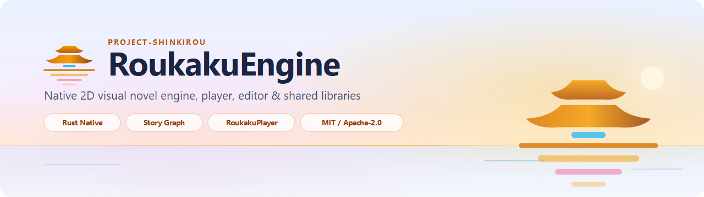

<picture>
  <source media="(prefers-color-scheme: dark)" srcset="docs/assets/readme-banner-dark.png">
  
</picture>

<div align="center">

# RoukakuEngine

**Native 2D visual novel engine, player, editor, and shared runtime in Rust.**

[](LICENSE-MIT)
[](https://project-shinkirou.github.io/en/status/)

English · [简体中文](README.zh-CN.md) · [日本語](README.ja.md)

[Portal](https://project-shinkirou.github.io/en/roukaku/) · [Documentation](https://project-shinkirou.github.io/en/roukaku/docs/) · [Quick Start](https://project-shinkirou.github.io/en/roukaku/docs/quick-start/) · [Project-Shinkirou](https://github.com/Project-Shinkirou)

</div>

---

> [!NOTE]
> **Project Status: feature development is paused.** RoukakuEngine ships no prebuilt binary releases. Its source code and documentation remain open and buildable from source, and its shared runtime libraries actively power [ShinkiEMU](https://github.com/Project-Shinkirou/ShinkiEMU). See [Project Status](https://project-shinkirou.github.io/en/status/).

## Components

| Component | Purpose |
|---|---|
| **Shared runtime** | Scenes, tasks, clocks, input, text layout, media, and resource management |
| **RoukakuVN** | Visual novel module — cooks `.roukaku` scripts and executes them through `VnSession` |
| **RoukakuPlayer** | Native runtime host loading packaged works and managing windows, devices, and platform events |
| **RoukakuEditor** | Integrated story graph, script text, timeline, inspector, and live Player preview |
| **`roukaku` CLI** | Script/UI validation, asset cooking, package building, and platform bundling |

## Get Started from Source

Install Rust (pinned in `rust-toolchain.toml`) and a native C/C++ toolchain, then follow the [build guide](docs/en/build.md):

```sh
cargo build --locked -p roukaku-cli -p roukaku-player -p roukaku-crash-reporter
cargo run --locked -p roukaku-cli -- --help
cargo run --locked --manifest-path Editor/Cargo.toml -p roukaku-editor -- Examples/NativeVN/project.yaml
cargo xtask check --workspace engine
cargo xtask check --workspace editor
```

Install the CLI into Cargo's bin directory:

```sh
cargo install --locked --path Engine/Source/Programs/roukaku-cli --bin roukaku
roukaku --help
```

Follow [Quick Start](docs/en/quick-start.md) to cook, package, and run the public sample project.

## Documentation

| Topic | English | 简体中文 | 日本語 |
|---|---|---|---|
| Overview | [index](docs/en/index.md) | [概览](docs/zh-cn/index.md) | [概要](docs/ja/index.md) |
| Quick start | [quick-start](docs/en/quick-start.md) | [快速上手](docs/zh-cn/quick-start.md) | [クイックスタート](docs/ja/quick-start.md) |
| Build | [build](docs/en/build.md) | [构建](docs/zh-cn/build.md) | [ビルド](docs/ja/build.md) |
| Architecture | [architecture](docs/en/architecture.md) | [架构](docs/zh-cn/architecture.md) | [アーキテクチャ](docs/ja/architecture.md) |
| Editor | [editor](docs/en/editor.md) | [编辑器](docs/zh-cn/editor.md) | [エディター](docs/ja/editor.md) |
| VN authoring | [vn-authoring](docs/en/vn-authoring.md) | [VN 创作](docs/zh-cn/vn-authoring.md) | [VN 制作](docs/ja/vn-authoring.md) |

[Contributing](CONTRIBUTING.md) · [Origins & Attribution](ORIGINS.md) · [Issues](https://github.com/Project-Shinkirou/RoukakuEngine/issues)

## Relation to ShinkiEMU

[ShinkiEMU](https://github.com/Project-Shinkirou/ShinkiEMU) is Project-Shinkirou's sister product for running existing visual novel engines. It consumes RoukakuEngine's shared libraries at a pinned Git revision; RoukakuEngine itself has no dependency on ShinkiEMU.

## License

Project-owned code is dual-licensed under [MIT](LICENSE-MIT) or [Apache-2.0](LICENSE-APACHE), at your option. Third-party code and assets keep their respective licenses and attribution.
